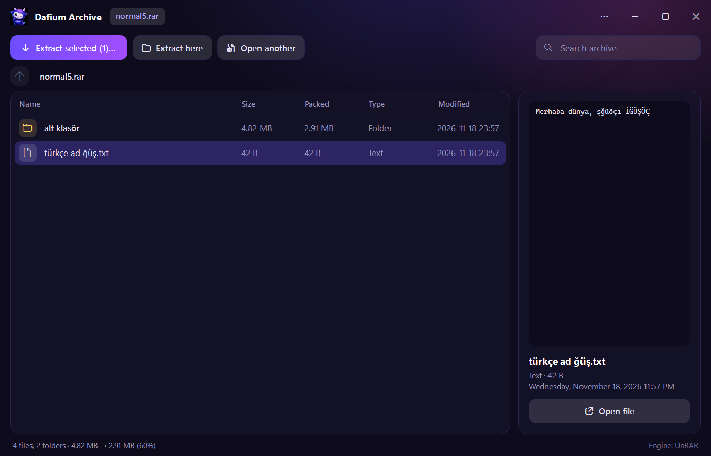

<p align="center">
  
</p>

<h1 align="center">Dafium Archive</h1>

<p align="center">
  A fast, ad-free, good-looking archive manager for Windows. Opens RAR, ZIP, 7z and more.<br>
  <i>Türkçe açıklama aşağıda.</i>
</p>

<p align="center">
  
</p>

## Features

- **Opens:** RAR (RAR4 and RAR5), ZIP, 7z, TAR, GZ, XZ, ZST, BZ2, LZ4, ISO, CAB and more
  - Encrypted archives (RAR, AES-256 ZIP, 7z with encrypted headers)
  - Multi-part RAR (`movie.part1.rar`, `part2` …), opening a middle part still reads from the start
  - Solid archives
- **Creates:** ZIP (optional AES-256 password), 7z, tar.zst
- **Preview:** images and text files without extracting
- **Drag & drop:** drop an archive to open it, drop files/folders to pack them, drag items out of the list into Explorer to extract
- **Explorer context menu** (optional, from the ⋮ menu): *Open with Dafium Archive*, *Extract here*, *Make ZIP*. Per-user, no admin needed.
- **Safe:** entries that try to escape the target folder (`..\..\Windows\…`, "zip slip") are blocked on every engine
- **Quiet:** no ads, no telemetry, no notifications, nothing running in the background
- **Languages:** English and Turkish (⋮ menu → Türkçe / English). Follows your Windows language on first start.

> **It can't create RAR files.** The RAR compressor is closed source and owned by RARLAB, which is also why 7-Zip doesn't create RAR.

## Download

Grab the latest zip from [**Releases**](../../releases), extract it anywhere and run `DafiumArsiv.exe`. No installer, no .NET runtime needed.

If Windows SmartScreen says "unrecognized app": **More info → Run anyway** (the exe isn't signed).

## Engines

| Format | Engine | License |
|---|---|---|
| RAR | [UnRAR](https://www.rarlab.com) (RARLAB) | UnRAR license (free, extraction only) |
| 7z | [7-Zip](https://www.7-zip.org) (Igor Pavlov) | LGPL 2.1 |
| Everything else + creating | [libarchive](https://www.libarchive.org) | BSD |

They live as separate DLLs in `native/`, not baked into the exe, so they can be swapped out (LGPL). To build them from source: [`scripts/motorlari-derle.ps1`](scripts/motorlari-derle.ps1).

## Building

```powershell
# needs the .NET 10 SDK
dotnet build -c Release
# portable build (single folder, no .NET needed):
dotnet publish -c Release -r win-x64 --self-contained -p:PublishSingleFile=true -o yayin
```

Tests (creating the sample archives needs WinRAR's `Rar.exe` and 7-Zip):

```bash
bash testler/ornekleri-olustur.sh /tmp/dafium-test
dotnet run --project testler/MotorTestleri -c Release -- /tmp/dafium-test
```

## Contributing

Reviews, bug reports and PRs are very welcome, see [CONTRIBUTING.md](CONTRIBUTING.md). Places that could use a second pair of eyes:

- the native interop in `Motor/UnrarArsiv.cs` and `Motor/SevenZipArsiv.cs`
- the `Guvenli` class in `Motor/Arsiv.cs` (path sanitizing / zip slip)
- speed and memory on very large archives

Identifiers in the code are Turkish (`Arsiv` = archive, `Cikar` = extract, `Kayit` = entry…). UI strings live in `Dil.cs`. Adding a language is mostly adding a column there.

## License

The app's own code is **MIT** licensed ([LICENSE](LICENSE)). The engines come with their own licenses: [THIRD-PARTY-NOTICES.txt](THIRD-PARTY-NOTICES.txt). The "Dafium" name and the "Dafi" mascot are not covered by the MIT license.

---

## Türkçe

**Dafium Arşiv**, Windows için hızlı, reklamsız ve güzel bir arşiv yöneticisi (WPF, .NET 10). Arayüz İngilizce ve Türkçe; ilk açılışta Windows dilini takip eder, ⋮ menüsünden değiştirilebilir.

- **Açar:** RAR4/RAR5 (şifreli, çok parçalı, solid), ZIP (AES-256 dahil), 7z (şifreli başlık dahil), TAR, GZ, XZ, ZST, BZ2, LZ4, ISO, CAB…
- **Oluşturur:** ZIP (isteğe bağlı AES-256 şifre), 7z, tar.zst. RAR oluşturamaz (RAR sıkıştırıcısı kapalı kaynak).
- Arşivi açmadan resim/yazı önizleme, içeri ve dışarı sürükle bırak, isteğe bağlı sağ tık menüsü (sadece bu kullanıcı için, yönetici izni gerekmez)
- Her motorda "zip slip" koruması
- Reklam yok, telemetri yok, arka planda çalışan bir şey yok

**İndir:** [Releases](../../releases) sayfasından zip'i indir, bir klasöre çıkar, `DafiumArsiv.exe`'yi çalıştır. SmartScreen uyarı verirse **Ek bilgi → Yine de çalıştır**.

Kodun kendisi MIT lisanslı; motorlar kendi lisanslarıyla gelir. İnceleme, hata bildirimi ve PR'lar memnuniyetle karşılanır.
